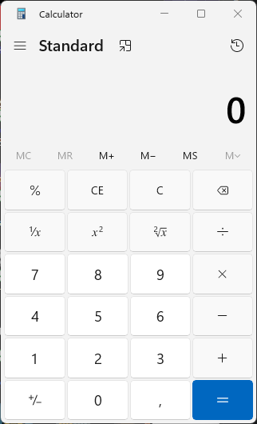
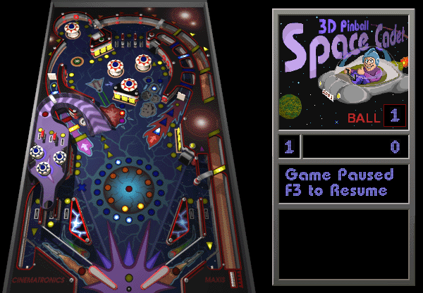
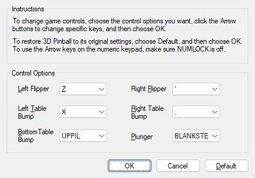

# Windows Reversed Tools AI

**From Windows binaries to Rust, with the original programs as the reference.**

An AI-assisted reverse engineering experiment: inspect a Windows executable,
recover what it actually does, implement that behavior in Rust, and compare the
result against the original. The first subjects are **Calculator** and
**3D Pinball — Space Cadet**. They turned out to be two very different projects.


<table>
  <tr>
    <td width="32%" valign="top">
      <strong>Calculator · aicalc</strong><br><br>
      
    </td>
    <td width="68%" valign="top">
      <strong>Space Cadet · aipinball</strong><br><br>
      
    </td>
  </tr>
</table>

*Actual verification captures. Calculator's interface belongs to the installed
Windows Calculator app; the rewritten executable launches it. Pinball's game
logic runs through the Rust execution engine.*

[The process](#how-the-reverse-engineering-worked) ·
[Verification](#what-has-been-verified) · [Build it](#build-and-run) ·
[Calculator details](docs/calculator.md) · [Pinball details](Pinball/README.md)

## Two executables, two approaches

| | Calculator | Space Cadet Pinball |
| --- | --- | --- |
| Reference | Windows 11 `calc.exe`, version 10.0.26100.8521 | Windows XP `PINBALL.EXE` supplied for this experiment |
| Original size | 26,624 bytes | 281,088 bytes |
| What the binary contains | A launcher for the packaged Calculator app | The game, rendering, physics, rules and Windows integration |
| Reconstruction | Function-by-function Rust translation | Decoded x86 intermediate representation executed by Rust instruction semantics |
| Output | `aicalc.exe` | `aipinball.exe` |
| Runtime requirements | Windows with Calculator installed | Windows and the original game data files |

**No original EXE files or prebuilt executables are distributed in this repo.**
Pinball's original game data and generated binary images are also excluded.
Provide the reference files locally when reproducing the analysis or tests.

## How the reverse engineering worked

### 1. Inspect the binary before deciding what to rebuild

The starting point was the executable: Portable Executable (PE) headers,
sections, imports, resources and disassembly. These reveal the architecture,
entry point, OS calls and data the program relies on.

Calculator provided the first surprise. This particular `calc.exe` is only a
launcher. Its main function registers a TraceLogging provider, conditionally
emits a startup event, and calls `ShellExecuteW` with `ms-calculator:`. The visible
calculator lives in a separate installed application.

That finding defined the implementation: reproduce the launcher, including its
startup and telemetry behavior. The arithmetic and interface remain those of
Windows Calculator. The recovered C-like representation and original addresses
are recorded in [calc_decompiled.c](decompiled/calc_decompiled.c).

### 2. Choose a representation that preserves the behavior

For Calculator, the recovered functions were small enough to translate directly
into Rust. The implementation includes startup handling, the security cookie,
TraceLogging metadata, API calls and the PE load configuration.

Pinball was larger: 135,980 bytes in its `.text` section, 207 imported symbols and
33 resource leaves. Capstone decodes its x86 instructions into an address-indexed
intermediate representation. The [Rust engine](Pinball/src/cpu.rs) implements
registers, memory, integer flags, branches, calls and stack operations; game logic
follows the original decoded instruction sequence.

This is a **machine-level reconstruction using an interpreted IR**. It does not
recover a high-level Rust version of the original C++ class hierarchy.


### 3. Preserve the details that change the result

- **Floating-point precision.** Pinball uses the x87 floating-point stack.
  Generated Rust inline assembly preserves its operations, status bits and
  precision settings, including across Windows callbacks.
- **Fixed addresses.** Original Pinball data uses absolute addresses. A PE layout
  step reserves a non-executable `.guest` section at those addresses and places
  compiled Rust code above it. Original instruction bytes are data; they are
  never executed as native game code.
- **Windows callbacks.** A small assembly bridge switches stacks, calls native
  APIs and routes callbacks into the Rust engine. Windows' thread stack bounds
  must match the active stack during these calls.
- **Compatibility metadata.** Pinball initially rendered into a client area ten
  pixels smaller in each direction. Matching the reference's OS and subsystem
  version fields restored the same sizing.
- **A fair comparison.** An unfocused Pinball window stops updating its game.
  Tests send the same focus notifications to both programs and compare a reset,
  paused checkpoint, so blinking lights and timing do not create false failures.

### 4. Use the original as a test oracle

A successful build was only the beginning. Checks compare resources, API
behavior, recovered math routines, window contents and clean shutdown. A separate
test launches rebuilt Pinball with its data in a directory containing no original
`PINBALL.EXE`.

AI assisted the analysis, implementation and debugging. The disassembly,
reproducible tooling and test evidence make the results inspectable.

## What has been verified

These are recorded local Windows results, not an exhaustive proof of equivalence
on every system or every possible game state.

| Check | Recorded result |
| --- | --- |
| Calculator unit tests | 22 tests covering startup, telemetry and mocked API behavior |
| Calculator screenshots | Reference and Rust-launched Calculator captures match pixel for pixel |
| Pinball integer semantics | Exhaustive byte addition/subtraction, including carry, borrow and overflow |
| Recovered vector normalization | 7 cases with exact float bits, return values and stack cleanup |
| Pinball resources | All 33 resource leaves match byte for byte |
| Paused Pinball playfield | **0 differing pixels out of 249,600** at the tested 600 × 416 checkpoint |
| Player Controls and High Scores | **0 differing pixels** in each tested dialog |
| Menus and execution | Matching menus; control commands, animated demo and exit code 0 |
| Independent execution | Rebuilt Pinball starts and exits with game data and no original EXE |

<table>
  <tr><th>Original Pinball</th><th>Rust execution engine</th></tr>
  <tr>
    <td></td>
    <td></td>
  </tr>
</table>

<details>
<summary>Player Controls dialog and machine-readable evidence</summary>



- [GUI comparisons](docs/verification/pinball-gui-report.json)
- [Resources, PE checks and independent launch](docs/verification/pinball-binary-report.json)
- [Recovered math checks](docs/verification/pinball-core-checks.json)

</details>

## Build and run

Use Windows with **Rust**, **MSVC Build Tools**, the **Windows SDK**, and **Python**.
Both projects target `i686-pc-windows-msvc`. Neither needs third-party Rust crates.

```powershell
git clone https://github.com/Mad-Mange/Windows-Reversed-Tools-AI.git
cd Windows-Reversed-Tools-AI
rustup target add i686-pc-windows-msvc
```

### Calculator

Recovered source and extracted build resources are included. Building the launcher
does not require the original `calc.exe`.

```powershell
cargo build --release
.\target\i686-pc-windows-msvc\release\aicalc.exe
```

For comparisons, supply the matching original as `calc.exe` in the repository
root, then run ` .\run_tests.ps1 ` (or ` .\run_tests.ps1 -SkipGui `).
The ETW capture test requires elevation and is skipped without it. See the
[Calculator notes](docs/calculator.md) for details and intentional differences.

### Pinball

Supply your own matching `PINBALL.EXE` in `Pinball/`, together with `PINBALL.DAT`,
`FONT.DAT`, WAV and MIDI files, `table.bmp`, and `wavemix.inf` from the same game
installation. These local inputs are ignored by Git.

```powershell
cd Pinball
python -m pip install -r requirements.txt
python tools/lift.py
python tools/check.py build --release
.\aipinball.exe
```

Run ` .\run_tests.ps1 ` from that folder for the full verification suite.
The original EXE is needed for regeneration and comparisons; the rebuilt game
runs with the data files alone.

**Launch `Pinball/aipinball.exe`, not the intermediate file under `target/`.**
The final PE layout transformation is required, so `cargo run` alone is not the
Pinball build-and-launch workflow.

## Explore the repository

| Path | Contents |
| --- | --- |
| [`src/`](src/) | Calculator startup and launcher behavior in Rust |
| [`decompiled/`](decompiled/) | Calculator disassembly, PE analysis and reconstructed C-like source |
| [`res/`](res/) | Calculator resources used by the build |
| [`tests/`](tests/) | Calculator binary, API, icon and window comparisons |
| [`Pinball/src/`](Pinball/src/) | Rust instruction semantics, x87 integration and Windows ABI bridge |
| [`Pinball/generated/`](Pinball/generated/) | Text disassembly, generated Rust and reference metadata; binary outputs are regenerated locally |
| [`Pinball/tools/`](Pinball/tools/) | Binary lifting, PE layout, debugger and verification tooling |
| [`docs/`](docs/) | Project notes, screenshots and recorded verification results |

## Scope and limitations

Calculator reconstructs a launcher for the installed app. Pinball reconstructs
machine-level behavior through Rust and an interpreted IR. Small assembly parts
remain for x87 operations and the Windows calling convention.

The tests cover the documented paths and images. Pinball's native-fault and
C-runtime SEH paths are not translated into host exception handlers. An
unsupported instruction on a previously untested path will trap. Legacy WinHelp
and audio/MIDI behavior depend on the host Windows installation. Timing and
performance are not guaranteed to match the reference.

Original Microsoft executables and Pinball data are not included. Screenshots
show the original product interfaces for comparison. This is an independent
experiment, not an official Microsoft project.

Useful contributions include reproducible differences, additional comparison
tests and explanations of recovered routines. Include the reference version/hash
and reproduction steps; keep original executables out of commits and attachments.
